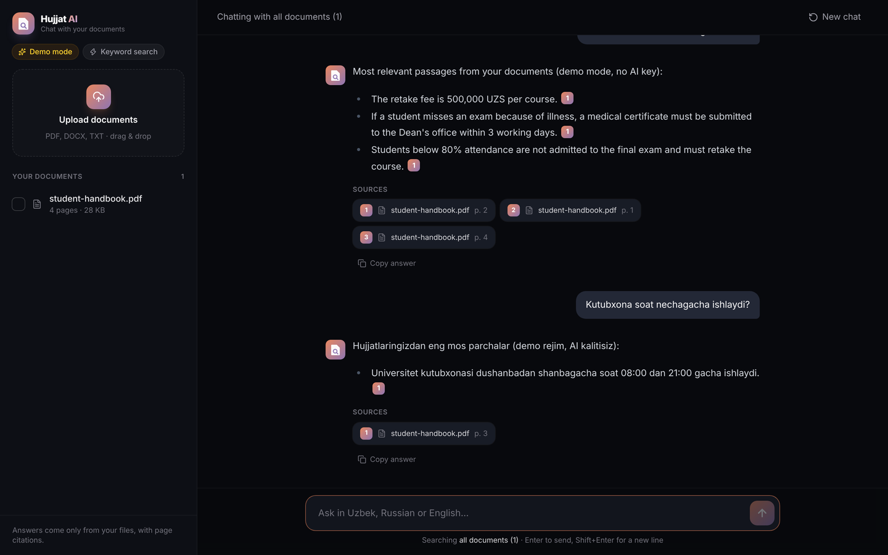
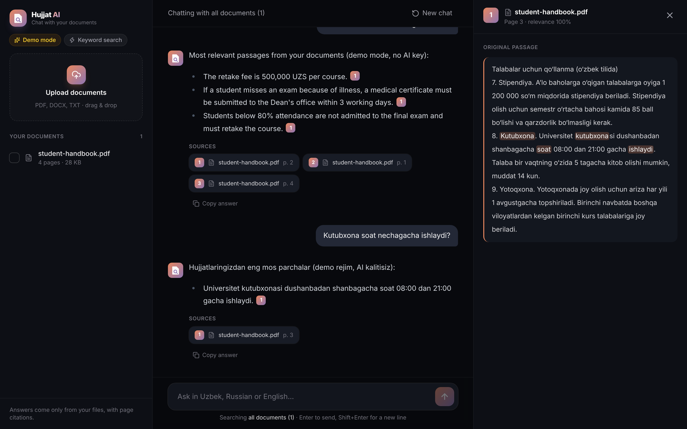
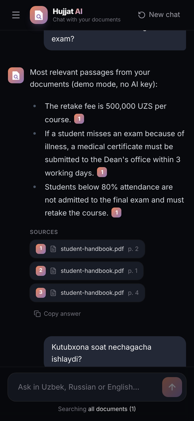
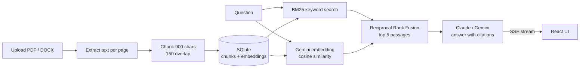

<div align="center">


# Hujjat AI

**Chat with your documents in Uzbek, Russian or English. Every answer cites the exact file and page.**




</div>

## Why

*Hujjat* means "document" in Uzbek. Students, lawyers and office workers in Uzbekistan spend hours searching
long PDFs (university rules, contracts, laws, company policies) that mix Uzbek, Russian and English.
Hujjat AI lets you upload those files and simply ask. It answers **only from your documents**, in the
language you asked in, and shows **which page** each fact came from, so you can verify it in one click.

## Features

- **Upload PDF, DOCX, TXT or Markdown**: text is extracted page by page and split into overlapping chunks.
- **Hybrid search (RAG)**: BM25 keyword search plus Gemini embeddings, merged with Reciprocal Rank Fusion.
- **Claude or Gemini answers**, streamed token by token over Server-Sent Events.
- **Citations you can click**: `[1]` chips open the original passage with your search words highlighted.
- **Multilingual**: ask in Uzbek, Russian or English. Uzbek apostrophes (oʻ, gʻ) are normalised for search.
- **Scope control**: tick documents in the sidebar to search only those files.
- **Works without an API key**: demo mode quotes the most relevant sentences, so anyone can try it.
- **Production-ready basics**: typed REST API with OpenAPI docs, 27 tests, CI, Docker, `.env` config.

| Source viewer | Mobile |
|---|---|
|  |  |

## How it works



**Why hybrid search?** Embedding models miss exact terms like article numbers, names and many Uzbek
words. Keyword search misses paraphrases ("cost" vs "fee"). Running both and fusing the rankings with
RRF gets the best of each without having to calibrate their scores against each other.

**Why not a vector database?** For thousands of chunks, NumPy cosine similarity over vectors stored in
SQLite is fast, has zero infrastructure, and keeps the retrieval logic easy to read. The `Retriever` class
is the single place to swap in pgvector or Chroma later.

## Quick start

### 1. Backend (Python 3.11+)

```bash
cd backend
python -m venv .venv && source .venv/bin/activate   # Windows: .venv\Scripts\activate
pip install -r requirements-dev.txt
cp ../.env.example ../.env                          # add ANTHROPIC_API_KEY and/or GEMINI_API_KEY
uvicorn app.main:app --reload
```

API docs: <http://localhost:8000/docs>

### 2. Frontend (Node 20+)

```bash
cd frontend
npm install
npm run dev
```

Open <http://localhost:5173> and click **"Try it with a sample student handbook"**.

### Or run everything with Docker

```bash
cp .env.example .env    # optional: add your keys
docker compose up --build
```

Open <http://localhost:8000>. The API also serves the built frontend.

## Configuration

| Variable | Default | What it does |
|---|---|---|
| `LLM_PROVIDER` | `auto` | `claude`, `gemini`, `demo`, or `auto` (Claude → Gemini → demo) |
| `ANTHROPIC_API_KEY` | | Enables Claude answers |
| `CLAUDE_MODEL` | `claude-haiku-5-5` | Any Claude model ID |
| `GEMINI_API_KEY` | | Enables Gemini answers **and** semantic search |
| `GEMINI_MODEL` | `gemini-2.5-flash` | Any Gemini model ID |
| `TOP_K` | `5` | Passages sent to the model per question |
| `CHUNK_SIZE` / `CHUNK_OVERLAP` | `900` / `150` | Chunking, in characters |

## API

| Method | Endpoint | Description |
|---|---|---|
| `GET` | `/api/health` | Active provider, search mode, document count |
| `GET` | `/api/documents` | List uploaded documents |
| `POST` | `/api/documents` | Upload a file (multipart `file`) |
| `DELETE` | `/api/documents/{id}` | Delete a document and its chunks |
| `POST` | `/api/chat` | Ask a question, get `{answer, sources}` |
| `POST` | `/api/chat/stream` | Same, streamed as SSE: `sources` → `token`… → `done` |

```bash
curl -F "file=@samples/student-handbook.pdf" localhost:8000/api/documents
curl -X POST localhost:8000/api/chat -H "Content-Type: application/json" \
     -d '{"question": "Kutubxona soat nechagacha ishlaydi?"}'
```

## Project structure

```
backend/
  app/
    main.py          FastAPI app, routes, serves the built frontend
    ingest.py        PDF/DOCX/TXT parsing and page-aware chunking
    retrieval.py     BM25 + embeddings + Reciprocal Rank Fusion
    embeddings.py    Gemini embeddings (optional)
    llm.py           Claude, Gemini and demo providers, prompt, citations
    db.py            SQLite store for documents, chunks and vectors
    routes/          /api/documents and /api/chat endpoints
  tests/             27 pytest tests (no network needed)
frontend/
  src/               React + TypeScript + Tailwind CSS UI
samples/             Fictional bilingual student handbook used for the demo
```

## Tests

```bash
cd backend && pytest && ruff check .
```

The tests cover parsing, chunking, Uzbek tokenisation, keyword and semantic retrieval, document filtering,
every API endpoint, the SSE stream, and the exact request sent to Claude and Gemini (using stub clients).

## Roadmap

- OCR for scanned PDFs (Tesseract with Uzbek language data)
- User accounts and private document collections
- Answer evaluation set to measure retrieval quality across languages

## Author

**Tanzila Nosirova** · Master's student at New Uzbekistan University · [github.com/emestienn](https://github.com/emestienn)

## License

MIT
